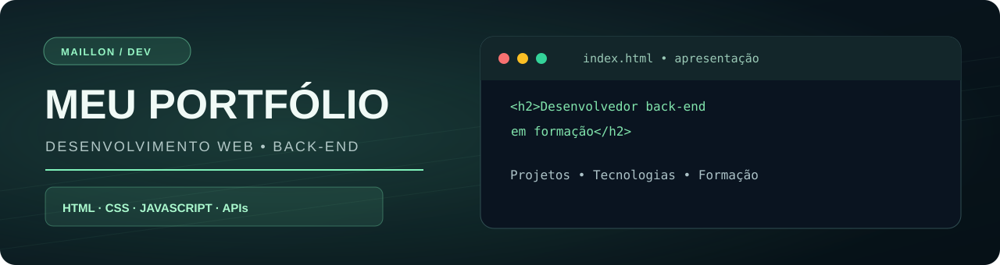

# Portfólio — Maillon Andrade

Portfólio pessoal de desenvolvimento de software, com foco em **back-end, APIs REST e aprendizado na prática**.

**[Ver site publicado](https://maillon49-prog.github.io/Portifolio/)** · **[GitHub](https://github.com/maillon49-prog)** · **[LinkedIn](https://www.linkedin.com/in/maillon-andrade-571905389/)**

## Sobre

Sou estudante de Análise e Desenvolvimento de Sistemas na UNINTER e estou construindo minha carreira em desenvolvimento back-end. O portfólio reúne projetos que fiz para estudar JavaScript, Node.js, Express, Java, lógica e integração de serviços.

A nova versão do site apresenta uma identidade visual **dark**, com detalhes em vermelho e roxo, organização responsiva e foco na clareza das informações para visitantes e recrutadores.

## Tecnologias do site

- **HTML5:** conteúdo semântico, navegação e apresentação dos projetos.
- **CSS3:** layout, responsividade, animações e componentes visuais.
- **JavaScript:** menu para celular, animações leves de entrada, indicação de seção e progresso de rolagem.
- Sem framework de interface, build obrigatório ou banco de dados no próprio site.

Outras ferramentas mostradas no portfólio representam minhas práticas e estudos nos projetos, e não dependências desta página.

## Projetos em destaque

| Projeto | O que mostra | Código |
| --- | --- | --- |
| JoKenPo com API | Comunicação de uma interface web com API Express | [Repositório](https://github.com/maillon49-prog/Jogo-de-JoKemPo-com-API) |
| Calculadora Full-Stack | Operações processadas no servidor, validação e histórico local | [Repositório](https://github.com/maillon49-prog/calculadora-Com-API) |
| Banco Java | Lógica de sistema bancário fictício em terminal | [Repositório](https://github.com/maillon49-prog/BancoJava) |
| Sistema Veterinário | Protótipo de cadastro e gerenciamento de pets com dados locais | [Repositório](https://github.com/maillon49-prog/Sistema-veterin-rio) |

**Observação:** projetos em evolução podem ter limitações. Demonstrações que usam APIs hospedadas em serviços externos dependem de esses servidores estarem disponíveis.

## Estrutura

~~~text
Portifolio/
├── assets/       # Artes e ilustrações dos projetos
├── img/          # Foto de perfil e ícones de tecnologias
├── index.html    # Conteúdo e links do portfólio
├── style.css     # Identidade visual e responsividade
├── script.js     # Navegação e interações acessíveis
└── README.md     # Documentação
~~~

## Executar localmente

Este portfólio é um site estático. Não é necessário iniciar um servidor de API para abrir esta página.

~~~bash
git clone https://github.com/maillon49-prog/Portifolio.git
cd Portifolio
~~~

Abra o arquivo **index.html** no navegador ou utilize o Live Server do VS Code.

## Acessibilidade e desempenho

- Links de pular para o conteúdo e estados de foco visíveis.
- Menu mobile com botão e atributo aria-expanded.
- Respeito à preferência por movimento reduzido.
- Imagens dos projetos carregadas sob demanda.
- Conteúdo permanece disponível mesmo sem JavaScript.

## Próximos passos

- Substituir ou complementar ilustrações de projeto por capturas reais das interfaces.
- Enriquecer os READMEs dos projetos com instruções de execução, exemplos e testes.
- Evoluir um sistema back-end com banco de dados e autenticação.
- Verificar regularmente os links das demonstrações.

---

Desenvolvido como parte da minha jornada de aprendizado. **[Acessar portfólio](https://maillon49-prog.github.io/Portifolio/)**.
