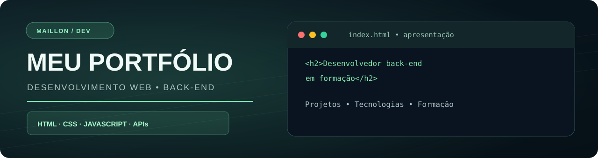
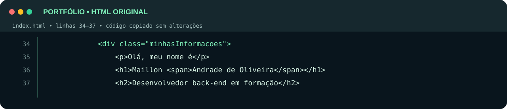

<p align="center">
  
</p>

<h1 align="center">Portfólio • Desenvolvimento Web</h1>

<p align="center">
  Um espaço para reunir meus projetos, mostrar o que aprendi e acompanhar minha evolução em programação, com foco em desenvolvimento back-end.
</p>

<p align="center">
  
  
  
  
  
</p>

<p align="center">
  <a href="https://github.com/maillon49-prog">Meu GitHub</a>
  &nbsp;·&nbsp;
  <a href="https://github.com/maillon49-prog/Portifolio">Código do portfólio</a>
  &nbsp;·&nbsp;
  <a href="https://www.linkedin.com/in/maillon-andrade-571905389/">LinkedIn</a>
</p>

---

## ✨ Sobre o projeto

Este é meu **portfólio pessoal**, construído para apresentar minha trajetória como desenvolvedor em formação e centralizar meus projetos de estudo e aplicações publicadas.

O site utiliza um visual **dark tech**, com tons de verde-menta e ciano, cartões interativos e uma estrutura que se adapta a telas de computador e celular.

### O que você encontra no site

- 👨‍💻 **Apresentação profissional:** quem sou e qual área estou buscando desenvolver.
- 🧰 **Tecnologias:** HTML, CSS, JavaScript, Node.js, Git, MySQL e APIs REST.
- 📚 **Estudos e formação:** cursos e temas que estou aprendendo.
- 🚀 **Projetos:** aplicações com links para demonstrações e repositórios.
- 📬 **Contato:** formas de conhecer meu trabalho e entrar em contato.

## 🛠️ Tecnologias do portfólio

| Tecnologia | Uso no site |
| :-- | :-- |
| **HTML5** | Estrutura semântica, seções e conteúdo |
| **CSS3** | Design dark, layout responsivo, efeitos e animações |
| **JavaScript** | Tecnologia utilizada nos projetos apresentados; a página atual do portfólio funciona com HTML e CSS |

> As tecnologias listadas na seção **Tecnologias** do site também incluem ferramentas que utilizo ou estudo nos meus projetos, como Node.js, Git, MySQL e APIs REST.

## 💻 Um trecho real do meu código

Este é um trecho **literal do meu arquivo [`index.html`](https://github.com/maillon49-prog/Portifolio/blob/main/index.html)**, onde apresento meu perfil de desenvolvedor.

<p align="center">
  
</p>

## 🚀 Projetos que aparecem no portfólio

| Projeto | Descrição | Acesso |
| :-- | :-- | :-- |
| **Calculadora Full-Stack** | Calculadora web integrada a uma API com Node.js e Express | [Abrir projeto](https://github.com/maillon49-prog/calculadora-Com-API) |
| **Banco Java** | Sistema bancário no terminal com login, saldo, depósito, saque e Pix fictício | [Abrir projeto](https://github.com/maillon49-prog/BancoJava) |
| **JoKenPo com API** | Pedra, papel e tesoura contra a CPU, com backend em Node.js | [Jogar](https://maillon49-prog.github.io/Jogo-de-JoKemPo-com-API/) |
| **Sistema Veterinário** | Cadastro e gerenciamento de pets em uma aplicação web | [Abrir projeto](https://github.com/maillon49-prog/Sistema-veterin-rio) |

## 📁 Estrutura do repositório

```text
Portifolio/
├── assets/
│   ├── readme-cover.svg   # Capa do README
│   └── codigo-real.svg    # Imagem com código verdadeiro do HTML
├── img/                   # Foto, ícones e recursos visuais
├── index.html             # Estrutura do portfólio
├── style.css              # Layout, cores e responsividade
├── script.js              # Arquivo JavaScript atualmente vazio
└── README.md              # Apresentação do repositório
```

## ▶️ Como executar localmente

O site é **estático**, portanto não precisa de Node.js ou banco de dados para rodar.

```bash
git clone https://github.com/maillon49-prog/Portifolio.git
cd Portifolio
```

Depois, abra o arquivo `index.html` no navegador ou use a extensão **Live Server** no VS Code.

## 🎯 Próximas melhorias

- [ ] Adicionar prévias visuais dos projetos.
- [ ] Evoluir o design da seção de projetos, mantendo a identidade dark tech.
- [ ] Aprimorar a apresentação das tecnologias e experiências.
- [ ] Continuar incluindo os novos sistemas que eu desenvolver.

---

<p align="center">
  Desenvolvido por <strong>Maillon Andrade de Oliveira</strong><br />
  <a href="https://github.com/maillon49-prog">GitHub</a> ·
  <a href="https://www.linkedin.com/in/maillon-andrade-571905389/">LinkedIn</a>
</p>
